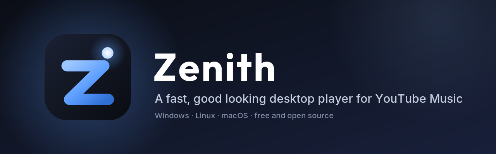
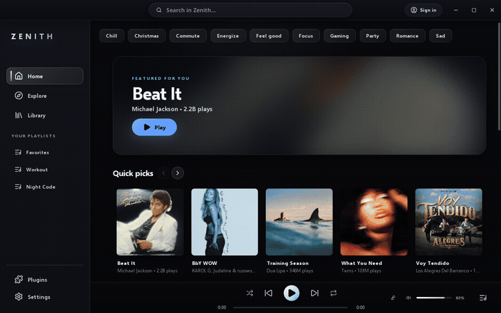
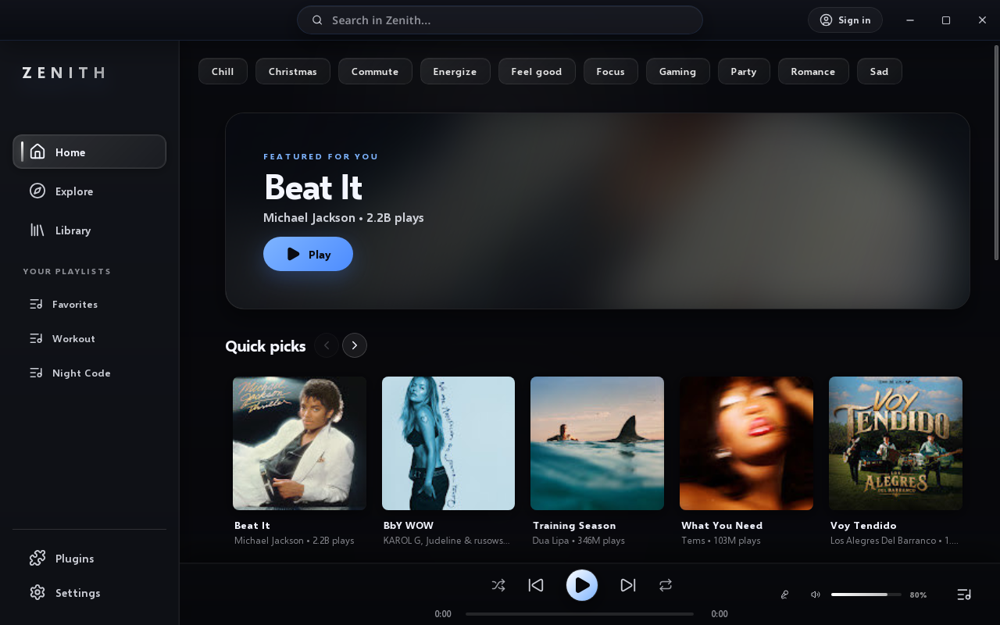
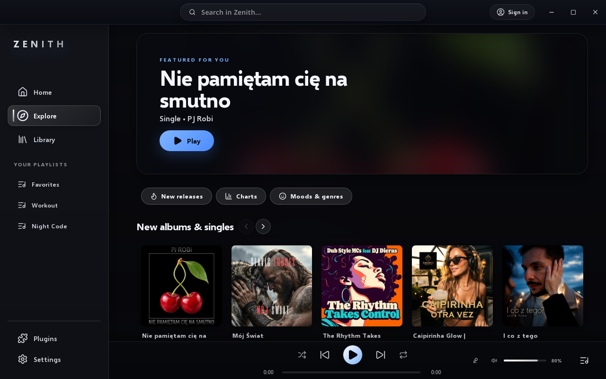
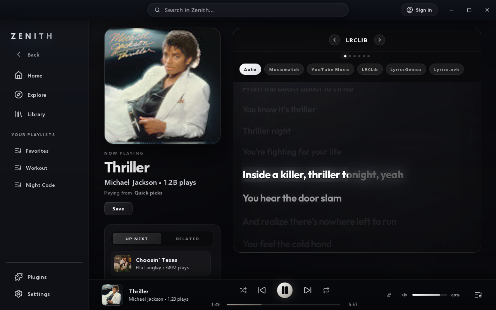
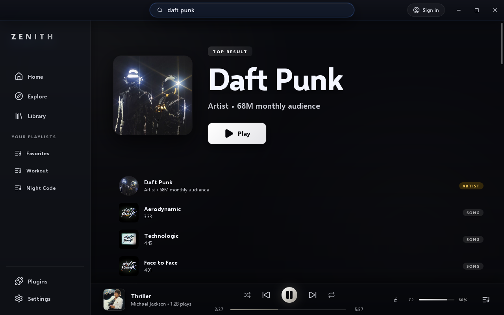
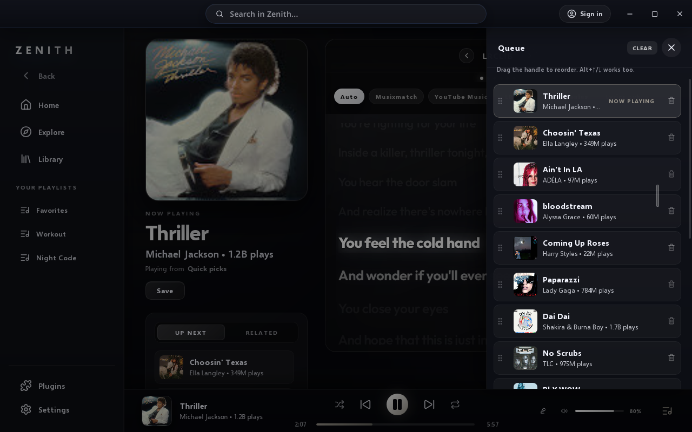
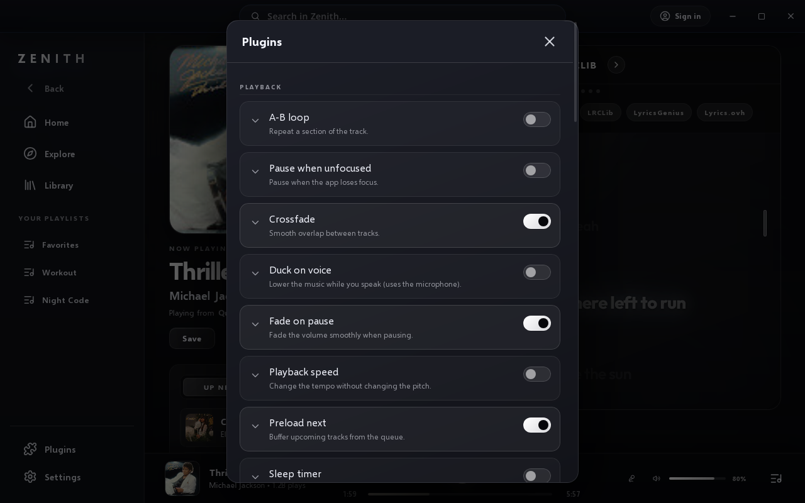
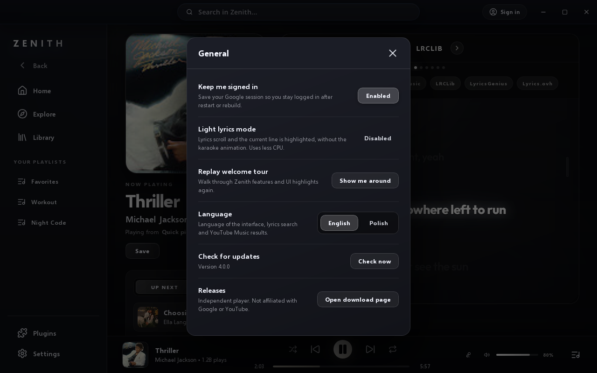

<p align="center">
  
</p>

<p align="center">
  <a href="https://github.com/tonieninja/zenith-player/releases/latest"></a>
  <a href="https://github.com/tonieninja/zenith-player/actions/workflows/build.yml"></a>
  <a href="./LICENSE"></a>
</p>

Desktop player for YouTube Music. Synced lyrics, gapless albums, a 15-band EQ, offline
downloads, a phone remote, and a bunch of plugins. No ads and no telemetry.

<p align="center">
  <a href="#download">Download</a> ·
  <a href="#features">Features</a> ·
  <a href="#screenshots">Screenshots</a> ·
  <a href="#phone-remote">Phone remote</a> ·
  <a href="#faq--troubleshooting">FAQ</a> ·
  <a href="#build-from-source">Build</a> ·
  <a href="docs/PLUGINS.md">Plugins</a>
</p>

<p align="center"></p>

Zenith is a native desktop app built with **Tauri 2** (Rust backend, React 19 + TypeScript UI).
It renders with **WebView2 on Windows** and **WebKitGTK on Linux**. Windows is the primary platform.

Zenith is an independent project. It is not a Google or YouTube product and does not host a
music catalog: browse data and playback come from YouTube Music. The MIT license covers Zenith
source code only. See [DISCLAIMER.md](./DISCLAIMER.md) and [NOTICE.md](./NOTICE.md).

---

## Download

Get the files from **[Releases → latest](https://github.com/tonieninja/zenith-player/releases/latest)**.

| Platform | File | Notes |
| --- | --- | --- |
| **Windows 10/11 (x64)**: installer | `Zenith_4.0.1_x64-setup.exe` | Recommended. Per-user install, English/Polish installer, embedded WebView2 bootstrapper, auto-update |
| **Windows 10/11 (x64)**: portable | `Zenith_4.0.1_x64_portable.exe` | Single file, no install. Installs/updates WebView2 on first start if it is missing or too old |
| Windows 10/11 (32-bit x86) | `Zenith_4.0.1_x86-setup.exe`, `Zenith_4.0.1_x86_portable.exe` | For 32-bit Windows only; on 64-bit Windows use x64 |
| Linux: Debian, Ubuntu, Mint, … | `Zenith_4.0.1_amd64.deb` | Pulls in WebKitGTK and the GStreamer plugins |
| Linux: Fedora, openSUSE, RHEL | `Zenith-4.0.1-1.x86_64.rpm` | `sudo dnf install ./Zenith-4.0.1-1.x86_64.rpm` |
| Linux: any distro | `Zenith_4.0.1_amd64.AppImage` | GStreamer bundled |
| macOS 11+ (Apple Silicon and Intel) | `Zenith_4.0.1_universal.dmg` | **Built by CI, untested.** Unsigned: right-click → *Open* the first time. Reports welcome |

Windows builds are not code-signed yet, so **SmartScreen may warn** about an unknown publisher:
choose *More info → Run anyway* after checking the file (see [Verifying downloads](#verifying-downloads)).

**Which file do I need?** On a normal Windows 10 or 11 PC take the x64 installer. If you
can't install things (school or work PC, USB stick) take the x64 portable exe. The x86 files are
only for old 32-bit Windows. Not sure? *Settings → System → About → System type* says
"64-bit" or "32-bit".

### Windows

- **Installer:** run `Zenith_4.0.1_x64-setup.exe`. It installs for the current user and sets up
  the WebView2 Runtime if needed.
- **Portable:** put `Zenith_4.0.1_x64_portable.exe` anywhere and run it. Before the window opens
  Zenith checks the WebView2 Runtime (version 100 or newer). If it is missing or older, Zenith
  downloads Microsoft's Evergreen bootstrapper and installs it silently, then starts. Settings and
  sign-in are still stored in `%LOCALAPPDATA%\com.zenithplayer.desktop`.

### Linux

```bash
# .deb
sudo apt install ./Zenith_4.0.1_amd64.deb

# AppImage
chmod +x Zenith_4.0.1_amd64.AppImage
./Zenith_4.0.1_amd64.AppImage
```

```bash
# .rpm (Fedora, openSUSE, RHEL)
sudo dnf install ./Zenith-4.0.1-1.x86_64.rpm
```

The AppImage needs FUSE 2 (`libfuse2`); without it, run with `APPIMAGE_EXTRACT_AND_RUN=1`.
Only x86_64 Linux builds are published. On ARM, build from source (see below).

### macOS

Open `Zenith_4.0.1_universal.dmg` and drag Zenith into *Applications*. The build is not signed
or notarized, so the first start needs *right-click → Open → Open* (or
`xattr -dr com.apple.quarantine /Applications/Zenith.app`). The macOS build comes out of CI and
nobody has tried it on a real Mac yet, so treat it as a preview and please report what you see.

### Auto-update

About 20 s after start Zenith checks
`https://github.com/tonieninja/zenith-player/releases/latest/download/latest.json` once. If a newer build exists, a toast offers
*Update*; the package is verified against the minisign public key in
[`src-tauri/tauri.conf.json`](src-tauri/tauri.conf.json) before it is installed. On Windows the
update package is the NSIS installer; if you use the portable exe, download the new file from
Releases instead. Settings → *Check for updates* runs the check on demand. Turn the automatic check
off with the `localStorage` key `zenith_auto_update_check=0`.

### Verifying downloads

Each release ships `SHA256SUMS` and a `.sig` (minisign, base64-encoded) per updater artifact.

```bash
sha256sum -c SHA256SUMS --ignore-missing
base64 -d Zenith_4.0.1_amd64.AppImage.sig > app.minisig
minisign -Vm Zenith_4.0.1_amd64.AppImage -x app.minisig \
  -P RWRtJM9nH1Zh+dusm+DR4rxB5RvUIIgghX3vuy5RLkDeCrHy3w+xOHau
```

On Windows: `Get-FileHash .\Zenith_4.0.1_x64_portable.exe -Algorithm SHA256`.

---

## Features

**Listening**
- Home, Explore (new releases, charts, moods and genres), Search and Library, all built from live YouTube Music shelves
- Queue with drag to reorder (or Alt+↑/↓), Up next and Related, shuffle, loop
- **Crossfade** between tracks (equal power, 2 to 12 s), plus fade on pause and smooth volume
- **Gapless albums**: when you play an album, the next track is loaded early and handed over with
  no gap between album tracks. Everything else still uses crossfade
- Fast starts: upcoming tracks are resolved ahead of time, stream links are cached until they
  expire, and two resolvers race each other on every new track
- A-B loop, variable speed with pitch kept, and a **sleep timer** (15 to 90 minutes)

**Sound**
- **Equalizer plugin**: 15 bands on the ISO 2/3 octave grid (25 Hz to 16 kHz), peaking filters,
  presets and an automatic preamp so boosts never clip. The **Bass Boost** preset lifts the low end
  (+4 dB at 25 Hz, +5.5 dB at 40 Hz, +5 dB at 63 Hz) and leaves vocals alone
- **Loudness normalization plugin**: loud masters are turned down to a common level, quiet ones are
  never pushed up
- Both run inside the audio engine (Web Audio on Windows and macOS, GStreamer on Linux) and cost
  well under 1% CPU

**Offline**
- **Offline downloads plugin**: save the current track to disk and play it with no connection.
  Downloads show title, artist, length and size, and you can play or delete them one by one or all at once
- Without internet Zenith shows an *Offline* badge instead of asking you to sign in again, and
  downloaded tracks keep playing

**Library and scrobbling**
- Optional Google sign-in for your library, playlists and liked songs
- Playlist folders in the sidebar (kept on this computer, YouTube Music is not changed)
- Last.fm scrobbling with your own free API key (now playing, scrobbles, offline queue)

**Lyrics**
- Providers: LRCLib, Musixmatch, Genius, lyrics.ovh and YouTube captions, with an *Auto* mode and per-provider switch
- Synced lyrics rail with karaoke fill; *Light lyrics mode* in Settings for slower PCs
- Always-on-top lyrics overlay and a fullscreen second-screen lyrics window

**Desktop**
- **Global hotkeys you can rebind**: play/pause, next, previous, volume up and down, like. Click a
  row in the plugin settings and press the new combination; it works while any other app has focus
- Close to tray and keep playing, tray menu, media keys
- On Linux, closing to the tray frees the WebView and playback continues in the native Rust/GStreamer engine
- Discord Rich Presence, DualSense controller, webhook / Stream Deck, share card, listening room (all optional plugins)
- **Phone remote** (*Control by your internet* plugin): run Zenith from your phone or any browser
  on the same Wi-Fi. Scan the QR code and you get now playing, the queue, search, lyrics and a
  sleep timer. [More below](#phone-remote)

**Account and privacy**
- The sign-in session stays on your device
- No telemetry, no analytics, no ads ([PRIVACY.md](./PRIVACY.md))
- Interface in **English** and **Polish**, switchable on the fly in Settings

All 36 plugins with their defaults are listed in [docs/PLUGINS.md](docs/PLUGINS.md).

### Keyboard shortcuts

| Keys | Action |
| --- | --- |
| Space | Play / pause |
| ← / → or P / N | Previous / next track |
| Shift + ← / → | Seek −10 s / +10 s |
| ↑ / ↓ | Volume |
| M | Mute |
| Ctrl+F or / | Search |
| Ctrl+Alt+Space, Ctrl+Alt+← / → | Global play/pause, previous/next (works in any app) |
| (unassigned, you pick) | Global volume up/down and like |

The in-app keys come from the *Keyboard Shortcuts* plugin. The global ones come from *Global
Hotkeys & Media Keys* and can be changed in its settings. Both are on by default. Some Linux
desktops keep Ctrl+Alt+↑/↓ for switching workspaces, so pick something else there.

---

## Playlist manager

Signed in, open **Manage playlists** in the sidebar (or right-click any song and pick it from
the menu). You get every playlist in one place: your own, saved ones, Liked Music and the mixes
YouTube makes for you, with search, sorting, track counts and covers.

- Your own playlists: rename, edit the description and privacy, delete (with a confirmation),
  remove tracks (tick several at once) and drag tracks to reorder. Changes go straight to
  YouTube Music.
- Any playlist: play it, duplicate it, merge it with another into a new playlist, add selected
  tracks to one of yours, save it as CSV or JSON in your Downloads folder.
- Right-click a song anywhere (search, library, related) to add it to one of your playlists.

### Export to Spotify

Zenith matches each track on Spotify by title, artists and length, creates a private playlist
and lists the tracks it could not find. Login uses OAuth with PKCE, so the app holds no client
secret, only a client ID:

1. Create an app at [developer.spotify.com/dashboard](https://developer.spotify.com/dashboard)
   (Web API).
2. Add the redirect URI `http://127.0.0.1:8766/callback` exactly like that.
3. Paste the app's **Client ID** in the export dialog, or build with
   `VITE_SPOTIFY_CLIENT_ID=<id> pnpm tauri build` to ship it as the default.

Spotify keeps apps in development mode limited to the accounts added under *User management*
in the dashboard, so add yourself there.

## Screenshots

Captured from the current build (Linux, 1280×800, not signed in).

| Home | Explore |
| --- | --- |
|  |  |
| **Now playing with synced lyrics** | **Search** |
|  |  |
| **Queue** | **Plugins** |
|  |  |
| **Settings** | |
|  | |

---

## Performance

Each number is the **total PSS of the whole process tree** (main + WebKit web + network
processes) of a release build, with no other WebKit/WebView app running.

### Low-end PC: no GPU, software rendering (Linux)

Xvfb 1440x900, no GPU. Soak: 25 one-minute cycles of playback in the lyrics view,
track change every third cycle.

| State | Result |
| --- | --- |
| Home, idle | 169 MB, 0.3% CPU |
| Playing, lyrics view (25-cycle soak) | 177-193 MB (short peaks: 216 MB, 204 MB) |
| Growth over the soak | none |
| Paused, player view | 0.3% CPU |
| In the tray, playing | ~100 MB, ~1% CPU (webview closed, native audio) |
| CPU, playing in the lyrics view | 27-110% (no GPU) |

- Total PSS briefly went over 200 MB twice: 216 MB right after the first track started and
  204 MB in cycle 22; both dropped back within a cycle.
- Lyrics-view CPU is the karaoke wipe and glow painted in software. With a GPU it should be
  lower; see the Windows table.

### Windows: Ryzen 5 3600, RX 6600 XT, 16 GB DDR4-3200, NVMe, 1920x1080 at 200 Hz

60 s samples during real playback (the position was checked to advance). Memory is the private
working set of `zenith-player.exe` plus all its `msedgewebview2` children. CPU is a share of the
whole 12-thread CPU, the way Task Manager shows it. Memory in the lyrics view depends on the track
(artwork, video, lyric length), so those are ranges over several tracks.

| State | Memory | CPU |
| --- | --- | --- |
| Home, idle | 69 MB | 0% |
| Playing, home view | 125 MB | 0.45% |
| Playing, lyrics view | 115-147 MB | 1.2-4.6% |
| Playing, lyrics view, window visible but unfocused | 118-147 MB | 4.4% |
| Paused, player view | 107-109 MB | 0% |
| Minimized, playing | 123-125 MB | 0.3% |
| In the tray, playing | 28-40 MB (one peak of 81 MB) | 0.1% |
| 8-minute soak, lyrics view, auto-advance | 141-187 MB, settles at about 147 MB | |

Measured with the installed x64 build, signed out of YouTube Music. Minimized keeps the webview
alive so it can come back instantly, but the karaoke wipe pauses, which is why CPU drops to 0.3%.
Closing to the tray releases the webview memory.

- When minimized or in the tray the WebView is hidden and asked to drop memory, so the page stops
  painting. Audio keeps playing and the next track still starts on time.
- Most of the lyrics-view CPU is the compositor redrawing the wipe and glow at the display rate
  (200 Hz on this monitor). A 60 Hz screen does less work, and Settings > Light lyrics mode turns
  the wipe off.
- The lyrics clock also stops completely while the window is hidden, and on Linux the video track
  of muxed streams is never decoded.

---

## Phone remote

Turn on **Plugins → Utility → Control by your internet**. Zenith starts a small web server on your
local network (default port `8765`) and shows its address (`http://192.168.x.x:8765/`) and a QR code.
Open it on any phone, tablet or computer on the same network; nothing to install.

- Live state over a WebSocket: title, artist, cover, progress, volume, like and the queue update
  instantly. The page counts the progress itself, so an idle connection sends nothing.
- Optional PIN (asked once per device, then remembered by that browser). Eight wrong PINs lock
  the server for 60 seconds.
- Only devices with a local address (192.168.x, 10.x, 172.16-31.x, 100.64/10, link-local,
  loopback) are answered; anything else gets `403`. Do not forward the port on your router.
- **One-time link mode** (instead of a PIN): the QR code carries a single-use pairing token. The
  device that opens it gets its own key and stays paired; the code then changes, so a photo of
  the QR is useless. *Forget all devices* in the plugin settings revokes every key.
- `http://zenith.local:8765/` also works on devices that support mDNS (iOS, macOS, Windows 10+,
  most Linux; Android Chrome often does not, use the IP there). Set `ZENITH_REMOTE_MDNS=0` to
  turn the announcement off.
- Phone page extras: **Lyrics** tab (synced, follows the song), **sleep timer** (15-90 min),
  hold ⏮/⏭ to scrub 5 s steps, and *Add to Home Screen* gives a full-screen app with an icon.
- When the plugin is off there is no server, no socket and no thread at all.
- **Windows:** the installer offers to add a firewall rule for Zenith limited to **private**
  networks (TCP, nothing on public networks). If you skipped it or use the portable exe, Windows
  Defender Firewall asks the first time: allow **Private networks**, or allow `zenith-player.exe`
  in *Windows Security → Firewall → Allow an app*. The network must be set to *Private*.
  **macOS** asks "accept incoming network connections" once. **Linux** firewalls (ufw, firewalld)
  need the port opened, e.g. `sudo ufw allow 8765/tcp`.

---

## FAQ & troubleshooting

<details>
<summary><b>Is this an official YouTube Music app?</b></summary>

No. Zenith is independent and not affiliated with Google or YouTube. See [DISCLAIMER.md](./DISCLAIMER.md).
</details>

<details>
<summary><b>Windows says <code>WebView2Loader.dll</code> is missing, or the window never opens</b></summary>

Zenith needs the Microsoft Edge WebView2 Runtime. The installer sets it up, and the app itself checks
for it at start: if it is missing or older than version 100, Zenith shows a notice, downloads the bootstrapper
from `go.microsoft.com` and installs it silently. If that fails (offline, blocked by a proxy or
policy), install the Evergreen runtime manually from
<https://developer.microsoft.com/microsoft-edge/webview2/> and start Zenith again.
Zenith supports Windows 10 and 11 only.
</details>

<details>
<summary><b>"Can't connect to YouTube Music" / Home stays empty</b></summary>

Zenith talks to `music.youtube.com` directly. Check, in this order:

1. **System clock.** A wrong date or time breaks TLS; turn on automatic time sync.
2. **Firewall / antivirus.** Allow `Zenith` (installed exe or the portable file) to access the
   internet. HTTPS scanning in some antivirus suites can break the connection.
3. **WebView2.** Make sure the runtime is installed and current (see above).
4. **Network.** School, work or public networks may block or filter YouTube. Try another network, a phone hotspot is the quickest test.
5. Run from a terminal with `ZENITH_DEBUG=1` and attach the log to a [bug report](https://github.com/tonieninja/zenith-player/issues/new/choose).

Zenith retries a failed YouTube Music browse request once before showing an error.

**Proxy and filtered networks (schools, offices).** Zenith uses the system proxy for the feed and the sign-in check (including automatic WPAD/PAC configuration) and the
Windows certificate store, which also covers firewalls that inspect TLS. This was tested with a proxy on a home
network. A real school network and a real Google login on one have not been tested yet; if
Home still fails or the sign-in window stays open, please
[open a bug report](https://github.com/tonieninja/zenith-player/issues/new/choose) with your
Windows version and, if you can, a `ZENITH_DEBUG=1` log (it contains no cookies).
</details>

<details>
<summary><b>Every track fails to play on a school / office network</b></summary>

Short answer: Zenith tries hard to get around it, but a network that really blocks YouTube can't
be beaten by any app, only by using another network.

What Zenith does on its own before it gives up on a track:

1. Two resolvers run at the same time (yt-dlp and YouTube's own player API), so one blocked path
   is not the end.
2. yt-dlp trusts the system certificate store, so filters that inspect HTTPS with the school's
   own root certificate work like in the browser.
3. The Windows proxy is picked up automatically, including WPAD and PAC scripts. If that proxy
   breaks YouTube, yt-dlp is retried without it, and so is the audio download itself.
4. If the certificate is still rejected, yt-dlp retries without checking it. Only the request
   for the link skips the check; the audio is still downloaded with full verification and only
   from YouTube's own servers.
5. On timeouts it retries over IPv4, then with other YouTube clients, then signed in, then it
   looks for another upload of the same song.
6. Whatever worked is remembered for the rest of the session, so the next tracks don't pay for the
   failed attempts again.

If it still fails after three tracks, the message tells you why:

- *"This network blocks or filters YouTube"*: the connection fails even after the fallbacks
  (filter, firewall, DNS block). Nothing to fix in the app; a phone hotspot is the quickest test.
- *"YouTube wants a sign-in from this network"*: many people share the school's IP and YouTube
  asks "confirm you're not a bot". Signing in fixes it most of the time.
- *"Couldn't download the playback component"*: yt-dlp comes from GitHub on first start and the
  network blocks GitHub. Start Zenith once on another network, after that it's cached.

For a bug report run Zenith with `ZENITH_DEBUG=1`. The log shows every attempt
(`yt-dlp fallback 'direct' failed`, `upstream route failed`, ...) and contains no cookies.

Honest note: the fallbacks were tested with a broken proxy and normal TLS on a home connection,
not on the actual school network where the problem was first reported.
</details>

<details>
<summary><b>A song skips or stops in the middle</b></summary>

YouTube sometimes rejects a stream link (HTTP 403) or rate-limits requests. Zenith then fetches
a new link through a different YouTube client and continues from the same point, and if no
client works it looks for another upload of the same song. It skips only after that, with a
growing pause between skips so a bad network does not race through the queue. No fallback can
catch every case: songs that are blocked in your country or removed are skipped.
</details>

<details>
<summary><b>Windows SmartScreen warns me</b></summary>

The builds are not code-signed yet, so new files have no SmartScreen reputation. Verify the
checksum (see [Verifying downloads](#verifying-downloads)), then *More info → Run anyway*.
</details>

<details>
<summary><b>Can I listen offline?</b></summary>

Yes, with the *Offline downloads* plugin. It saves tracks inside Zenith's own app data folder so
Zenith can play them without a connection. They are for listening in Zenith, not for exporting or
sharing, and Zenith has no export button on purpose.
</details>

<details>
<summary><b>Is signing in safe?</b></summary>

Sign-in is optional and happens on the normal Google login page inside a WebView. Zenith never sees
your password; session cookies stay on your machine (DPAPI-protected on Windows, file mode `0600` on Linux).
</details>

<details>
<summary><b>Why yt-dlp?</b></summary>

It resolves playable stream URLs reliably. Zenith downloads it into its app data folder and keeps
it updated; it is not bundled in the repository or installers.
</details>

<details>
<summary><b>High CPU in the lyrics view?</b></summary>

The karaoke animation is painted every frame. Without a GPU (software rendering) that is expensive.
Turn on *Settings → Light lyrics mode* to keep line highlighting without the animation.
</details>

<details>
<summary><b>Where is my data? How do I reset?</b></summary>

Everything is in the app data directory: `%LOCALAPPDATA%\com.zenithplayer.desktop` on Windows,
`~/.local/share/com.zenithplayer.desktop` on Linux. Quit Zenith and delete it to reset.
</details>

---

## Build from source

**Requirements**

- Node.js 20+ and pnpm 10+ (`packageManager` in `package.json` pins pnpm 10.18.3)
- Rust stable (see `rust-toolchain.toml`)
- Windows: WebView2 Runtime and the MSVC build tools
- Linux: `libwebkit2gtk-4.1-dev libgstreamer1.0-dev libgstreamer-plugins-base1.0-dev libayatana-appindicator3-dev librsvg2-dev`
  (CI also installs `patchelf libasound2-dev libudev-dev`)

```bash
pnpm install
pnpm tauri dev        # run with hot reload (restart after Rust changes)
pnpm test             # vitest
pnpm typecheck
pnpm format:check
pnpm tauri build      # release bundles for the current OS
```

| Platform | Artifacts | How |
| --- | --- | --- |
| Windows | NSIS installer, MSI, portable zip (`x64`, `x86`) | `pnpm dist:win` (PowerShell, signs if a cert is configured) |
| Windows portable exe | single `zenith-player.exe` | cross-built with `cargo xwin`, see [docs/RELEASING.md](docs/RELEASING.md) |
| Linux | `.deb`, `.rpm`, `.AppImage` (amd64) | `pnpm tauri build --bundles deb,rpm,appimage`, or `pnpm dist:linux` from Windows (Docker or WSL) |
| macOS | universal `.dmg` + updater `.app.tar.gz` | `pnpm tauri build --target universal-apple-darwin --bundles app,dmg` |

CI ([`.github/workflows/build.yml`](.github/workflows/build.yml)) runs on pull requests, manual dispatch
and `v*` tags: `pnpm test`, `cargo test`, Playwright end-to-end tests of the phone remote page
(`pnpm e2e`, against the real Rust server), then Windows x64 + x86 (setup +
portable), Linux `.deb`/`.rpm`/`.AppImage` and the macOS universal `.dmg`. With the
`TAURI_SIGNING_PRIVATE_KEY` secret set, updater signatures and a `latest.json` covering every
platform are produced; on a tag everything is attached to a draft release with `SHA256SUMS`.
Release steps: [docs/RELEASING.md](docs/RELEASING.md). Contributing: [CONTRIBUTING.md](./CONTRIBUTING.md).

Local builds are still subject to the [YouTube Terms of Service](https://www.youtube.com/t/terms)
and [Google Terms of Service](https://policies.google.com/terms).

### How it works

| Component | Implementation |
| --- | --- |
| Catalog | YouTube Music InnerTube (browse, search, library); home and explore paginate with continuation tokens |
| Playback | Windows: HTML `<audio>` in WebView2. Linux: native GStreamer engine in Rust (two decks, crossfade); falls back to `<audio>` if GStreamer plugins are missing |
| Stream URL | yt-dlp (prints the URL and its headers, writes no file) and InnerTube `/player` race, first usable link wins; network fallbacks (direct, system certs, IPv4); links cached until their `expire` time; on 403/429 the proxy re-resolves through another client and resumes at the same byte |
| Local proxy | `127.0.0.1` only, token-protected, so the WebView can fetch googlevideo (CORS); also serves the resized cover-art cache (64 MB cap) |
| Startup | Checks GitHub for a newer yt-dlp and fetches a current InnerTube `clientVersion`, without blocking the UI |
| Sign-in | Optional Google login in a separate WebView; cookies stay on this device |
| Plugins | `src/plugins/*.ts` implement `ZenithPlugin`, registered in `src/plugins/index.ts` |
| Phone remote | `src-tauri/src/remote.rs` (axum HTTP + WebSocket, LAN-only, optional PIN), page in `src-tauri/remote/index.html` embedded in the binary |

| Window label | Entry | Role |
| --- | --- | --- |
| `main` | `index.html` | Main UI |
| `mini-player` | `mini.html` | Compact always-on-top player |
| `lyrics-overlay` | `overlay.html` | Floating lyrics |
| `lyrics-second` | `overlay.html` | Second-screen lyrics |
| `google-login` | created at runtime | Sign-in WebView |

```
zenith-player/
├── src/                  React UI (TypeScript)
│   ├── api/              YouTube Music InnerTube client, lyrics providers
│   ├── audio/            audio backends (web dual-deck, native bridge)
│   ├── components/       views, player, lyrics, panels
│   ├── plugins/          ZenithPlugin implementations + registry
│   ├── mini/, overlay/   mini player and lyrics overlay windows
│   ├── i18n.ts           UI strings (EN/PL)
│   └── utils/            helpers, plugin strings, updater
├── src-tauri/            Rust backend (Tauri 2)
│   ├── src/              stream, proxy, native audio, tray, cover cache, WebView2 check, ...
│   ├── native/           LD_PRELOAD pageout helper (Linux)
│   ├── vendor/wry/       wry 0.55.1 + memory pressure patch
│   └── tauri.conf.json
├── assets/brand/         logo kit: source SVGs, variants, PNGs, banners
├── scripts/              build, signing, release helpers (brand/build-brand.py rebuilds all icons)
├── docs/                 screenshots, PLUGINS.md, RELEASING.md
└── .github/              CI workflow, issue/PR templates
```

## Performance tuning (Linux)

Zenith is tuned for low memory and CPU on machines without a GPU. Environment overrides:

| Variable | Effect |
| --- | --- |
| `ZENITH_RENDER=gpu` | keep WebKit's default (DMA-BUF/EGL) renderer even if no render node is found |
| `ZENITH_WEBKIT_CACHE=browser\|viewer` | WebKit cache model (default: document browser) |
| `GLIBC_TUNABLES` | if set, replaces Zenith's default malloc tunables |
| `ZENITH_AUDIO=web` | play through the webview instead of the native GStreamer engine |
| `ZENITH_JIT=1` | re-enable the JavaScriptCore JIT (off by default) |
| `ZENITH_WEBKIT_MP=off` | disable the web process memory pressure settings |
| `ZENITH_AUDIO_SINK=<element>` | GStreamer sink element for the native engine (default: `autoaudiosink`) |
| `ZENITH_DEBUG=1` | verbose logging |

---

## Logo and brand assets

Everything lives in [`assets/brand`](assets/brand): the layered source SVG, the full logo and the
small-size icon, white, black and blue marks, a light version, wordmarks, the README banner and the
1280x640 social preview, plus PNGs from 16 to 1024 px. `python scripts/brand/build-brand.py`
rebuilds all of it and every app icon from the two source files. See
[assets/brand/README.md](assets/brand/README.md).

---

## Translations

The UI ships in **English** and **Polish** (Settings → Language). Strings live in
[`src/i18n.ts`](src/i18n.ts), plugin names/descriptions in
[`src/utils/pluginI18n.ts`](src/utils/pluginI18n.ts), and the installer languages in
`bundle.windows.nsis.languages` in [`src-tauri/tauri.conf.json`](src-tauri/tauri.conf.json).
To add a language, add a full set of strings in both files and open a pull request.

---

## License

[MIT](./LICENSE) © 2026 tonieninja and contributors.
Third-party material and trademarks: [NOTICE.md](./NOTICE.md).
Relationship to YouTube and Google: [DISCLAIMER.md](./DISCLAIMER.md).
Security: [SECURITY.md](./SECURITY.md) · Privacy: [PRIVACY.md](./PRIVACY.md) · Code of conduct: [CODE_OF_CONDUCT.md](./CODE_OF_CONDUCT.md).
