<picture>
  <source media="(prefers-color-scheme: dark)" srcset="assets/hero-dark.svg">
  
</picture>

<p align="center">
  <a href="https://github.com/tonieninja/zenith-player/releases/latest"><b>download</b></a>
  &nbsp;·&nbsp;
  <a href="#what-it-does">what it does</a>
  &nbsp;·&nbsp;
  <a href="docs/PLUGINS.md">plugins</a>
  &nbsp;·&nbsp;
  <a href="#building">build it yourself</a>
</p>


Desktop player for YouTube Music. Tauri 2 (Rust) with a React UI. Synced lyrics, gapless albums,
crossfade, a 15-band EQ, offline downloads, a phone remote and a pile of plugins. No ads, no telemetry.

> [!NOTE]
> Zenith is an independent, unofficial app. It isn't affiliated with, endorsed by, sponsored by or
> connected to Google or YouTube in any way, it's just a player that talks to YouTube Music. Your
> account and YouTube's terms still apply. YouTube, YouTube Music and Google are trademarks of Google LLC.

## Download

<a href="https://github.com/tonieninja/zenith-player/releases/latest">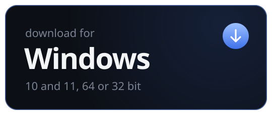</a><a href="https://github.com/tonieninja/zenith-player/releases/latest">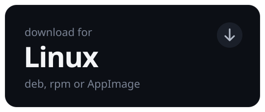</a><a href="https://github.com/tonieninja/zenith-player/releases/latest"></a>

Windows builds aren't signed, so SmartScreen will complain. More info, Run anyway.
On macOS right click, Open the first time (or System Settings, Privacy & Security, Open Anyway). `SHA256SUMS` is attached to every release.

<details>
<summary>Which file do I need?</summary>

| System               | File                                                                             |
| -------------------- | -------------------------------------------------------------------------------- |
| Windows 10/11        | `Zenith_4.1.2_x64-setup.exe` (or `_x64_portable.exe` if you can't install stuff) |
| Old 32-bit Windows   | `Zenith_4.1.2_x86-setup.exe` / `_x86_portable.exe`                               |
| Debian, Ubuntu, Mint | `Zenith_4.1.2_amd64.deb`                                                         |
| Fedora, openSUSE     | `Zenith-4.1.2-1.x86_64.rpm`                                                      |
| Any Linux            | `Zenith_4.1.2_amd64.AppImage`                                                    |
| macOS 11+            | `Zenith_4.1.2_universal.dmg` (built by CI, I don't have a Mac to test it)        |

</details>

## What it does


And the rest:

- Home, Explore, Search, Library, queue with drag and drop, shuffle, loop, radio after the queue ends
- Crossfade (2 to 12 s), gapless albums, A-B loop, speed with pitch kept, sleep timer
- Audio runs in a small Rust engine (symphonia + cpal), EQ and loudness normalization included.
  If it can't start, the app falls back to the old HTML audio
- Lyrics from LRCLib, Musixmatch, Genius, lyrics.ovh and YouTube captions, karaoke fill,
  always-on-top overlay and a second screen window
- Offline downloads, Last.fm scrobbling, Discord presence, DualSense, global hotkeys you can rebind
- Phone remote over your Wi-Fi (QR code, optional PIN, nothing leaves the LAN)
- Optional Google sign-in for your library, the session stays on your machine
- English and Polish

Full plugin list: [docs/PLUGINS.md](docs/PLUGINS.md).

<details>
<summary>All screenshots</summary>

|                                               |                                             |
| --------------------------------------------- | ------------------------------------------- |
| 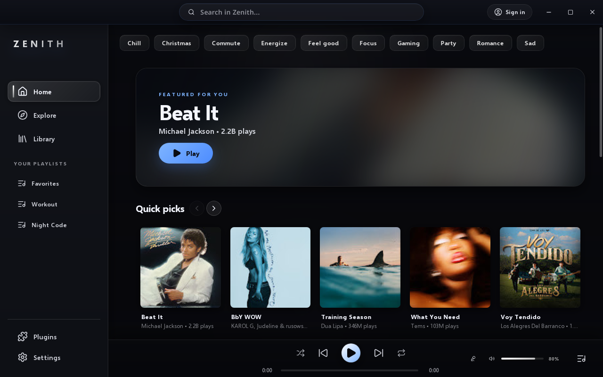         |  |
| 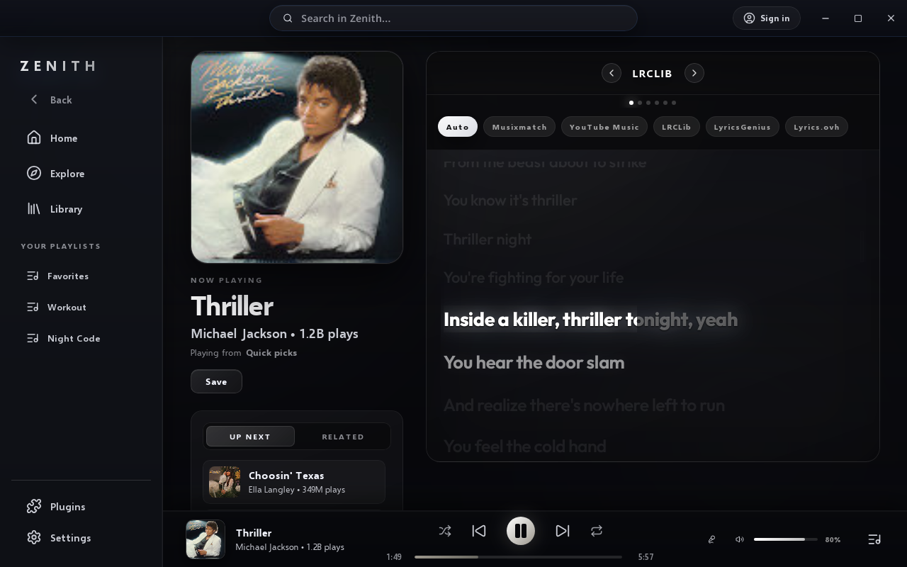     | 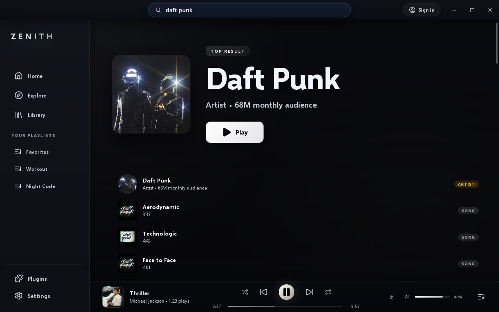   |
| 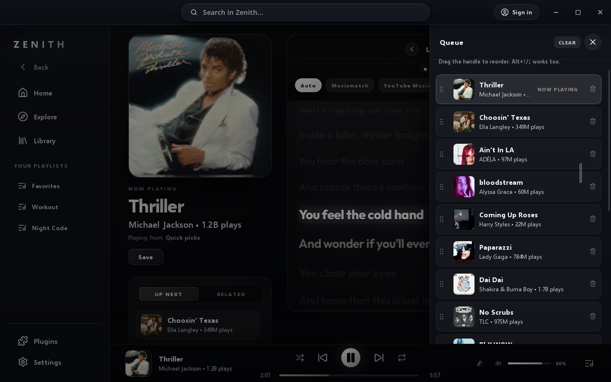       | 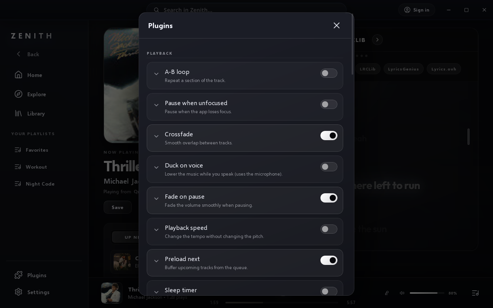 |
| 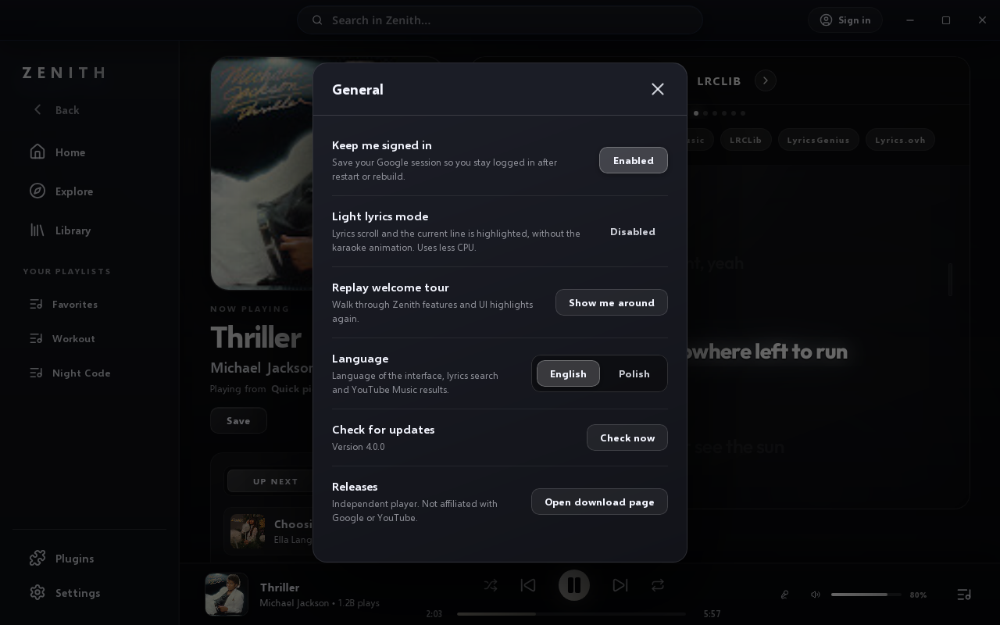 |                                             |

</details>

## Phone remote

Turn on _Plugins, Utility, Phone remote_. You get an address like
`http://192.168.x.x:8765/` and a QR code, open it on your phone on the same network.
Only local addresses get an answer. On Windows allow it on **private** networks when the firewall
asks, on Linux open the port (`sudo ufw allow 8765/tcp`). With the plugin off there's no server at all.

## Problems

- Window doesn't open on Windows: it needs the WebView2 Runtime. The installer sets it up,
  the portable exe installs it on first start.
- Home stays empty / can't connect: Zenith talks to `music.youtube.com` directly and trusts
  the Windows certificate store, so a proxy with its own root cert is fine. If it still fails,
  run it with `ZENITH_DEBUG=1` and open an issue with the log (no cookies in it).
- Every track fails at school or work: if the network really blocks YouTube there's not
  much to do. The error tells you why after three tracks.
- High CPU in lyrics: without a GPU the karaoke fill is expensive, turn on _Settings, Light lyrics mode_.
- Reset: delete `%LOCALAPPDATA%\com.zenithplayer.desktop` on Windows or
  `~/.local/share/com.zenithplayer.desktop` on Linux.

## Support

Zenith is free and stays free. If it saves you a Premium subscription and you want to say thanks,
[buy me a coffee](https://buymeacoffee.com/tonieninja). There's the same link in Settings, About.

## Building

Node 20+, pnpm 10, Rust stable. On Linux also
`libwebkit2gtk-4.1-dev libasound2-dev libayatana-appindicator3-dev librsvg2-dev`.

```bash
pnpm install
pnpm tauri dev
pnpm test && pnpm typecheck && pnpm lint
pnpm tauri build
```

CI in `.github/workflows/build.yml` builds Windows x64/x86, Linux deb/rpm/AppImage and the mac dmg.

Yes, I know `App.tsx` is around 6000 lines. It's a crime and someone should probably shoot me for it,
but that's life. I hack on this on my knees and it's just easier for me with everything in one place.

RAM on Linux sits around 250 MB with the window open and most of that is WebKit itself. Closing to
the tray drops the UI completely, so the player alone uses a lot less.

## Privacy

This program will not transfer any information to other networked systems unless specifically
requested by the user or the person installing or operating it. Playing music talks to YouTube
Music, lyrics come from lyrics sites, and Discord, Last.fm, Spotify export and the phone remote only
connect once you turn them on. The update check asks GitHub for the latest release, you can turn it
off in Settings. Your Google cookies stay on your computer and only go to Google.

The microphone is only used by the Voice ducking plugin to lower the music while you talk,
and only while that plugin is on. Nothing gets recorded or sent anywhere, settings, history and
your session stay on your computer.

## License

MIT, see [LICENSE](LICENSE). YouTube and Google names and logos belong to Google, the music and
lyrics belong to whoever owns them.
