<picture>
  <source media="(prefers-color-scheme: dark)" srcset="assets/hero-dark.svg">
  
</picture>

<p align="center">
  <a href="#download"><b>download</b></a>
  &nbsp;·&nbsp;
  <a href="#what-it-does">what it does</a>
  &nbsp;·&nbsp;
  <a href="docs/PLUGINS.md">plugins</a>
  &nbsp;·&nbsp;
  <a href="#building">build it yourself</a>
</p>

<a href="https://github.com/tonieninja/zenith-player/releases/latest"></a>

## Download

<a href="https://github.com/tonieninja/zenith-player/releases/latest">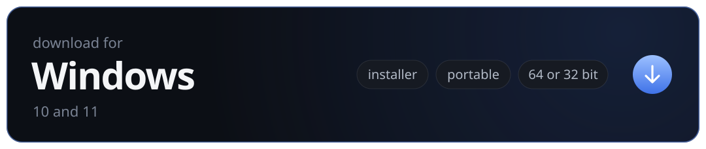</a><a href="https://github.com/tonieninja/zenith-player/releases/latest"></a><a href="https://github.com/tonieninja/zenith-player/releases/latest">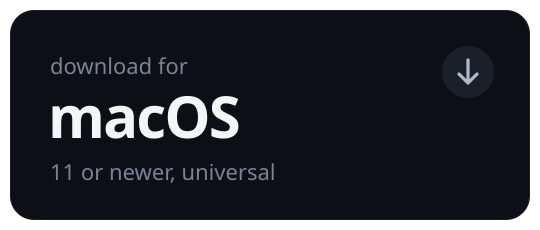</a>

With [Scoop](https://scoop.sh): `scoop bucket add zenith https://github.com/tonieninja/scoop-zenith`, then `scoop install zenith/zenith`.

<details>
<summary>Which file do I need?</summary>
<br>

| System               | File                                                                             |
| -------------------- | -------------------------------------------------------------------------------- |
| Windows 10/11        | `Zenith_4.6.0_x64-setup.exe` (or `_x64_portable.exe` if you can't install stuff) |
| Old 32-bit Windows   | `Zenith_4.6.0_x86-setup.exe` / `_x86_portable.exe`                               |
| Debian, Ubuntu, Mint | `Zenith_4.6.0_amd64.deb`                                                         |
| Fedora, openSUSE     | `Zenith-4.6.0-1.x86_64.rpm`                                                      |
| Any Linux            | `Zenith_4.6.0_amd64.AppImage`                                                    |
| macOS 11+            | `Zenith_4.6.0_universal.dmg` (built by CI, I don't have a Mac to test it)        |

Windows builds aren't signed, so SmartScreen will complain. More info → Run anyway.
On macOS right click → Open the first time (or System Settings → Privacy & Security → Open Anyway). `SHA256SUMS` is attached to every release.

</details>

## What it does


And the rest:

- Home, Explore with charts, moods and genres, Search, and a Library with podcasts and history
- Playlists you can edit, merge and reorder, synced back to YouTube Music, plus local folders for the sidebar
- Artist pages with Play all, which plays every song of the artist like a playlist
- Queue with drag and drop, shuffle, loop, and a radio that keeps going after the last track
- Speed with the pitch kept, A-B loop, sleep timer, bass boost and a limiter so loud presets don't clip
- Last.fm and ListenBrainz scrobbling, Discord presence, DualSense, global hotkeys you can rebind
- Playlists go to Spotify and come back from it, matched track by track, or out to CSV and JSON
- Listening Room for friends on the same network, a now playing card and a webhook for Stream Deck
  or Home Assistant
- Optional Google sign-in for your library, the session stays on your machine
- English and Polish

Full plugin list: [docs/PLUGINS.md](docs/PLUGINS.md).

<details>
<summary>Screenshots</summary>
<br>

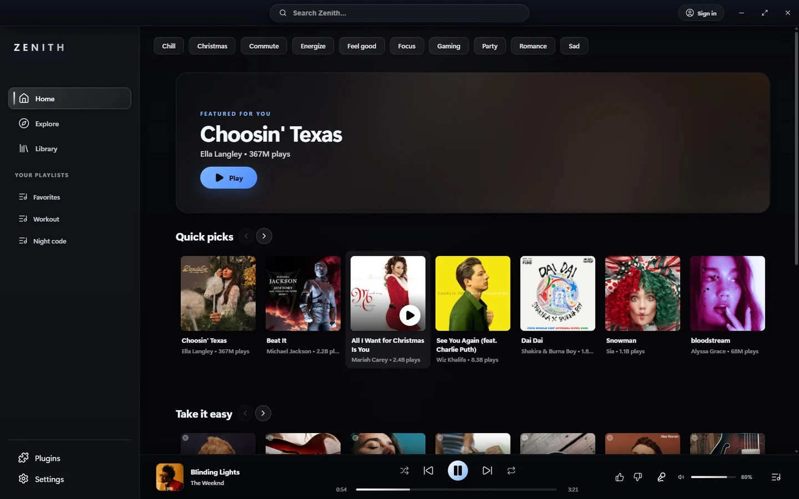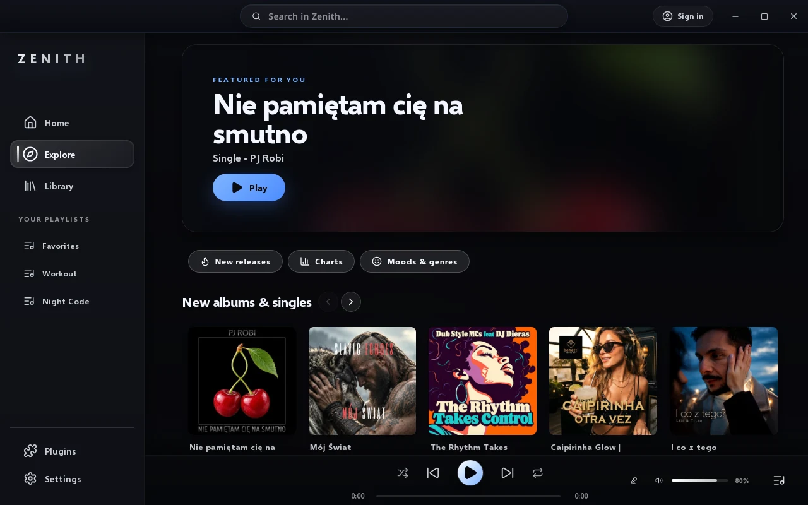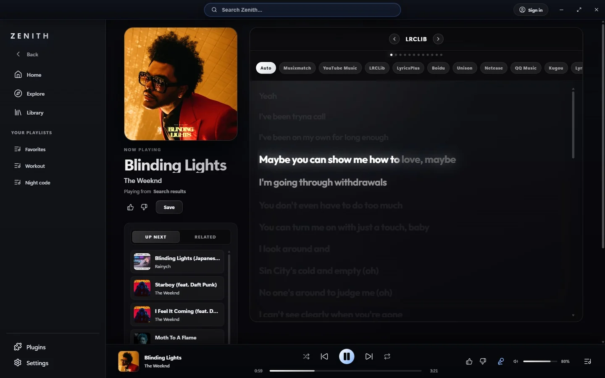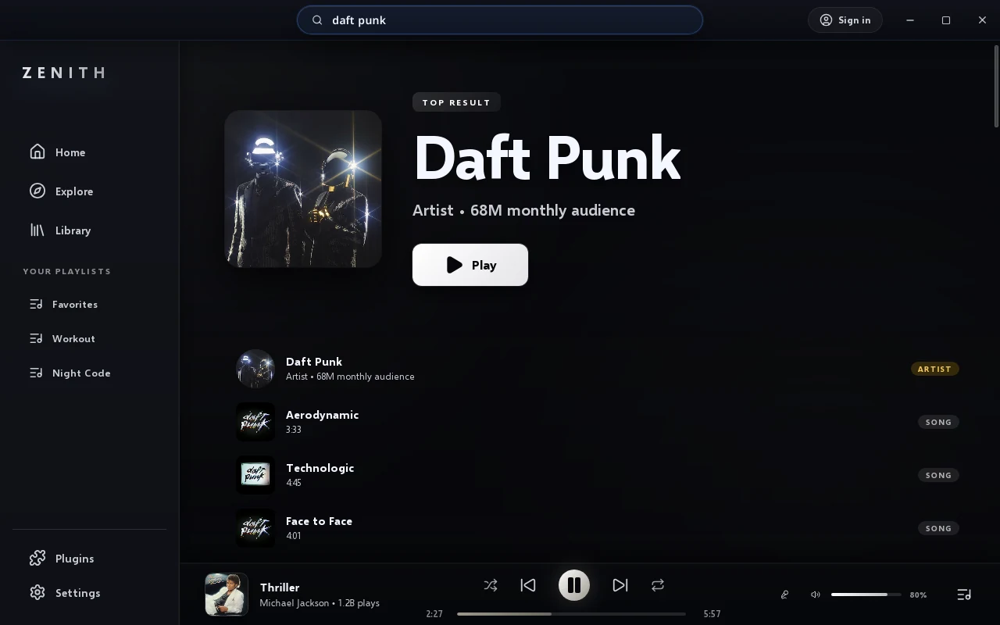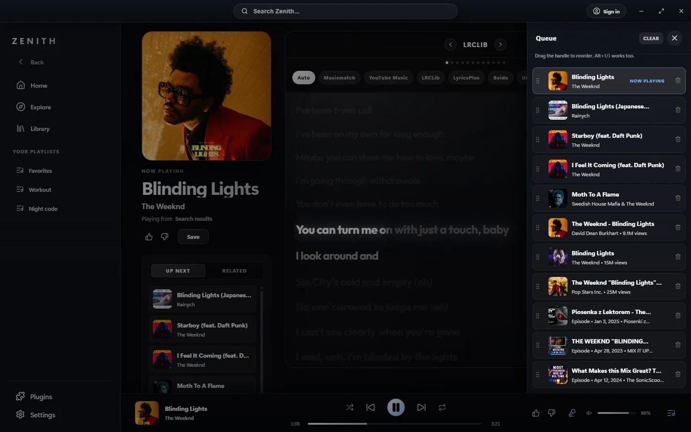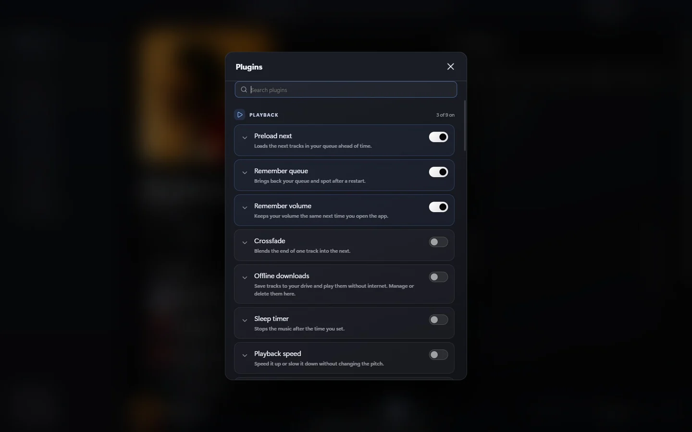

</details>

## RAM


| What's open               | RAM     |
| ------------------------- | ------- |
| Main window + mini player | ~260 MB |
| Main window               | ~130 MB |
| Tray + mini player        | ~55 MB  |
| Tray only, just the music | ~15 MB  |

Closing to the tray drops the main window after 30 s and the Rust engine keeps playing. With the
mini player closed too there's no WebView2 running at all. Measured on Windows 11 with a Japanese
song playing, synced lyrics and romanization on, private memory of every Zenith and WebView2
process added up. The tray numbers settle about a minute after the window goes away.

## Phone remote

Turn on _Plugins → Control and remote → Phone remote_. You get an address like
`http://192.168.x.x:8765/` (or `http://zenith.local:8765/`) and a QR code, open it on your phone on the
same network. Only local addresses get an answer. On Windows tick the firewall option at the end of the
installer or use the button in the plugin, on Linux open the port (`sudo ufw allow 8765/tcp`).
With the plugin off there's no server at all.

## Offline downloads

Downloaded tracks are plain files on your disk, so you can copy them to a USB stick or a phone:

- Windows: `%LOCALAPPDATA%\com.zenithplayer.desktop\downloads`
- Linux: `~/.local/share/com.zenithplayer.desktop/downloads`
- macOS: `~/Library/Application Support/com.zenithplayer.desktop/downloads`

Files are named `Artist - Title [video id].webm` (sometimes `.m4a`), the same audio YouTube Music
streams, and most players and phones open them as they are. Downloads from before 4.3.1 get renamed like
that the next time Zenith starts. They aren't MP3s, so for an old MP3 player convert them first, for
example `ffmpeg -i "Artist - Title [id].webm" -q:a 2 "Artist - Title.mp3"`.

## Problems

- Window doesn't open on Windows: it needs the WebView2 Runtime. The installer sets it up,
  the portable exe installs it on first start.
- Home stays empty: run Zenith with `ZENITH_DEBUG=1` and open an issue with the log, there are
  no cookies in it. Proxies with their own root cert are fine.
- Every track fails at school or work: the network blocks YouTube. The error says so after three tracks.
- Phone remote can't connect at school or in a hotel: Windows marks that network as Public. Allow it in
  the plugin (only on a network you trust); some school Wi-Fi also blocks devices from seeing each other.
- Age-restricted song: Zenith plays the same song from YouTube Music instead. A few have no version
  without the age check, those need a signed-in account that Google has age-verified.
- High CPU in lyrics: turn on _Settings → Light lyrics mode_.
- Reset: delete `%LOCALAPPDATA%\com.zenithplayer.desktop` and `%APPDATA%\com.zenithplayer.desktop`
  on Windows, or `~/.local/share/com.zenithplayer.desktop` on Linux.

## Support

Zenith is free and stays free. If it saves you a Premium subscription and you want to say thanks,
[buy me a coffee](https://buymeacoffee.com/tonieninja). There's the same link in Settings, About.

Big thanks to [melo](https://github.com/melo-foundation/) for all his help with testing, bug reports and
debugging Zenith on Linux on his own machine: Fedora KDE on Wayland, a laptop RTX 3080 Ti and a 4K
screen at 200% scale.

## Building

Node 20+, pnpm 10, Rust stable.

```bash
pnpm install
pnpm tauri dev
pnpm test && pnpm typecheck && pnpm lint
pnpm tauri build
```

<details>
<summary>Linux packages</summary>
<br>

```bash
sudo apt install build-essential cmake pkg-config libwebkit2gtk-4.1-dev libgtk-3-dev \
  libayatana-appindicator3-dev librsvg2-dev libssl-dev patchelf libudev-dev libunwind-dev \
  libgstreamer1.0-dev libgstreamer-plugins-base1.0-dev gstreamer1.0-plugins-base \
  gstreamer1.0-plugins-good gstreamer1.0-libav libasound2-dev
```

Add `rpm` if you want the rpm; CI builds the deb and rpm on Ubuntu 22.04. The AppImage is built in an Arch Linux
container and carries its own glibc (`Dockerfile.linux`, `pnpm dist:linux`).

</details>

CI in `.github/workflows/build.yml` runs the tests, lint, clippy and Playwright, then builds Windows
x64/x86/ARM64 (setup, msi and portable), Linux deb/rpm/AppImage and the mac dmg.

Yes, I know `App.tsx` is around 6000 lines. It's a crime and someone should probably shoot me for it,
but that's life. I hack on this on my knees and it's just easier for me with everything in one place.

On Linux most of the RAM with the window open is WebKit itself. Closing to the tray drops the UI
completely, so the player alone uses a lot less. On NVIDIA under Wayland Zenith turns off NVIDIA
explicit sync, which WebKitGTK can't start with. If the faster DMA-BUF renderer still doesn't come up,
the next start uses the slower one by itself until the next update. If WebKit crashes or stops
responding later on, Zenith restarts on the slower one right away. `ZENITH_RENDER=gpu` skips all of
that, and anything you set yourself wins.

## Privacy

This program will not transfer any information to other networked systems unless specifically
requested by the user or the person installing or operating it.

Music comes from YouTube Music and lyrics from lyrics sites. Discord, Last.fm, ListenBrainz, Spotify,
the webhook, the phone remote and lyrics translation (lines go to Google Translate) connect only
after you turn them on. SponsorBlock only gets the first 4 characters of a hash of the video id.
Japanese romanization downloads its dictionary from jsDelivr once.
On start Zenith asks GitHub if there's a newer release.
Settings, history and your Google cookies stay on your computer, and the
cookies only ever go to Google. The microphone is used only by the Voice ducking plugin while it's on,
and nothing is recorded.

<br>

<p align="center">
  
</p>

<p align="center">
  <sub>
    MIT, see <a href="LICENSE">LICENSE</a>. Bundled third-party code is listed in <a href="THIRD_PARTY_NOTICES.md">THIRD_PARTY_NOTICES.md</a>. <a href="CODE_SIGNING.md">Code signing policy</a>.<br>
    Zenith is an independent project, not affiliated with, endorsed by or sponsored by Google or YouTube.<br>
    YouTube, YouTube Music and Google are trademarks of Google LLC. The music and lyrics belong to whoever owns them.
  </sub>
</p>
