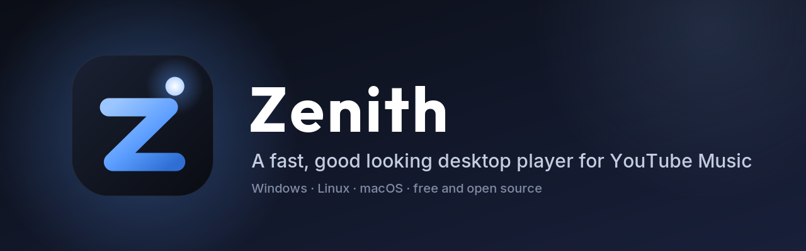
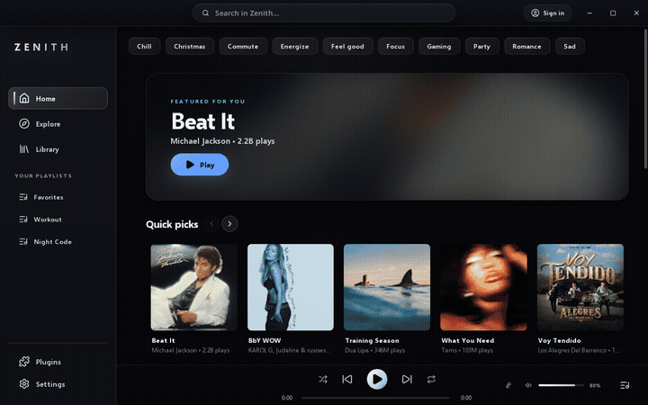

  

# Zenith Player

Desktop player for YouTube Music. Tauri 2 (Rust) with a React UI. Synced lyrics, gapless albums,
crossfade, a 15-band EQ, offline downloads, a phone remote and a pile of plugins. No ads, no telemtry.

Not an official YouTube or Google thing, just a player that talks to YouTube Music. Your account
and YouTube's terms still apply.

## Download

Grab it from [Releases](https://github.com/tonieninja/zenith-player/releases/latest).

| System               | File                                                                             |
| -------------------- | -------------------------------------------------------------------------------- |
| Windows 10/11        | `Zenith_4.0.0_x64-setup.exe` (or `_x64_portable.exe` if you can't install stuff) |
| Old 32-bit Windows   | `Zenith_4.0.0_x86-setup.exe` / `_x86_portable.exe`                               |
| Debian, Ubuntu, Mint | `Zenith_4.0.0_amd64.deb`                                                         |
| Fedora, openSUSE     | `Zenith-4.0.0-1.x86_64.rpm`                                                      |
| Any Linux            | `Zenith_4.0.0_amd64.AppImage`                                                    |
| macOS 11+            | `Zenith_4.0.0_universal.dmg` (built by CI, I don't have a Mac to test it)        |

Windows builds aren't signed, so SmartScreen will complain. More info, Run anyway.
On macOS right click, Open the first time. `SHA256SUMS` is attached to every release.

## What it does

- Home, Explore, Search, Library, queue with drag and drop, shuffle, loop, radio after the queue ends
- Crossfade (2 to 12 s), gapless albums, A-B loop, speed with pitch kept, sleep timer
- Audio runs in a small Rust engine (symphonia + cpal), EQ and loudness normalization included.
  If it can't start, the app falls back to the old HTML audio
- Lyrics from LRCLib, Musixmatch, Genius, lyrics.ovh and YouTube captions, karaoke fill,
  always-on-top overlay and a second screen window
- Offline downloads, Last.fm scrobbling, Discord presence, DualSense, global hotkeys you can rebind
- Phone remote over your Wi-Fi (QR code, optional PIN, nothing leaves the LAN)
- Optional Google sign-in for your library, the session stays on your machine
- English and Polish

Full plugin list: [docs/PLUGINS.md](docs/PLUGINS.md).

## Screenshots

